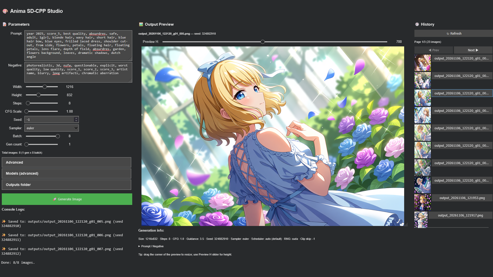

# Anima Turbo Colab

## Info

Utilizing [circlestone-labs's Anima](https://huggingface.co/circlestone-labs/Anima) ([turbo]()) model to generate anime styled artworks right in Google Colab's UI without too much dependencies. 

Uses [stable-diffusion.cpp](https://github.com/leejet/stable-diffusion.cpp) as its backend and ipywidgets for the UI.

## Features

- Text to image
- Saving to Google Drive (optional)
- History (optionally importing your past gens from Drive)
- Metadata as a .txt sidecar

## Limitations

- No Image to image / image reference
    -  Can't figure it out, sry.
- No LoRAs, embedding
- To put it simply, this is just pure T2i
    - no fancy stuff
- No tag weighting syntaxes
    - e.g.: `(1girl:1.2)`, `[tag]`

## Credits to

- [leejet](https://github.com/leejet) for [stable-diffusion.cpp](https://github.com/leejet/stable-diffusion.cpp)
    - NUROISEA (me, lol) for [sd-cli binary for colab](https://github.com/NUROISEA/sdcpp-google-colab-cuda-binary)
- [vanes430](https://huggingface.co/vanes430) for [Anima-Turbo-V1.1 Q8 GGUF](https://huggingface.co/vanes430/Anima-Turbo-V1.1-GGUF/blob/main/anima-turbo-v1.1-Q8_0.gguf)
- [mradermacher](https://huggingface.co/mradermacher) for [Qwen3-0.6B-Base Q8_0 gguf](https://huggingface.co/mradermacher/Qwen3-0.6B-Base-GGUF/blob/main/Qwen3-0.6B-Base.Q8_0.gguf)

## AI Disclosure

I didn't write a single line for ipywidgets, but it was vetoed thoroughly by me. All UI decision is by me.

### Models (Openrouter)

- DeepSeek V4.1 Flash 1017
- Muse Spark 1.3 Contributor